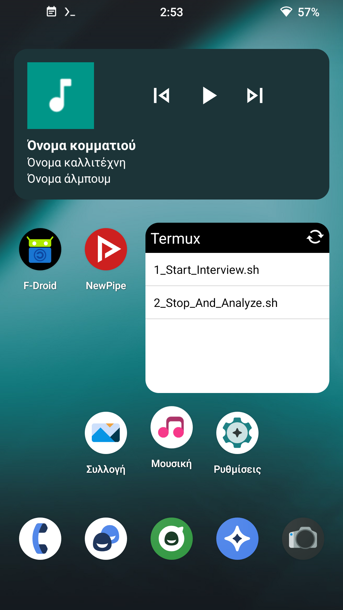
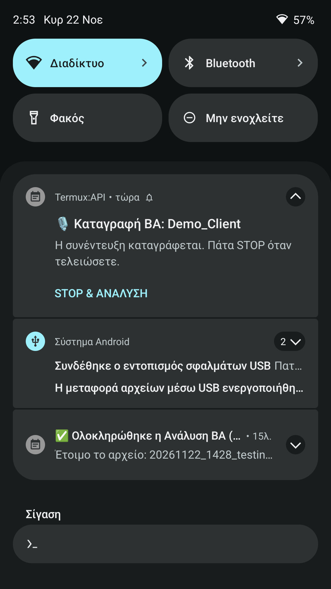

# Offline Business Analyst Recorder & AI Analyzer (Xiaomi Redmi Note 4 / LineageOS 20.0)

## 1. Σκοπός / Περιγραφή (Overview)

Η παρούσα τεκμηρίωση περιγράφει την εγκατάσταση, τη ρύθμιση και τη χρήση ενός πλήρως αυτόνομου (offline) συστήματος καταγραφής, απομαγνητοφώνησης και ανάλυσης συνεντεύξεων Business Analysis (BA) πάνω σε συσκευή **Xiaomi Redmi Note 4 (`mido`, `aarch64`)** με **LineageOS 20.0 (Android 13)** και **Termux**.

Η αρχιτεκτονική λειτουργεί 100% από την οθόνη αφής (touch-first) χωρίς πληκτρολόγιο και χωρίς σύνδεση στο διαδίκτυο κατά τη χρήση:
1. **Καταγραφή Ήχου:** Το `termux-microphone-record` (μέσω `Termux:API`) καταγράφει τη συνέντευξη σε μορφή AAC (`.m4a`), ενώ το `ffmpeg` τη μετατρέπει αυτόματα σε 16 kHz mono PCM `.wav`.
2. **Απομαγνητοφώνηση (Speech-to-Text):** Το `whisper.cpp` (`whisper-cli`) με το quantized ελληνικό μοντέλο `ggml-small-q5_1.bin` παράγει πλήρη απομαγνητοφώνηση στα Ελληνικά.
3. **Map-Reduce Ανάλυση Απαιτήσεων (LLM):** Για να αποφεύγεται η απώλεια πληροφοριών σε πολύωρες συναντήσεις, το κείμενο κατατέμνεται ανά 1.200 λέξεις. Το `llama.cpp` (`llama-completion`) με το μοντέλο `Qwen2.5-1.5B-Instruct (Q4_K_M)` εξάγει γεγονότα ανά τμήμα (Map) και στη συνέχεια συνθέτει ένα δομημένο **Business Analysis Report** σε Markdown (Reduce).

---

## 2. Προαπαιτούμενα (Prerequisites)

### Συσκευή & Λειτουργικό
- **Συσκευή:** Xiaomi Redmi Note 4 (`mido`, `aarch64`) με LineageOS 20.0 (Android 13) και επαρκή ελεύθερο χώρο (~2 GB για κώδικα, dependencies και μοντέλα).
- **Σύνδεση Wi-Fi:** Απαιτείται μόνο κατά την αρχική εγκατάσταση πακέτων και τη λήψη των μοντέλων.
- **Υπολογιστής Linux (προαιρετικά για αυτοματοποιημένη εγκατάσταση):** `android-tools` (`adb`), `curl`, `ssh`.

### Εφαρμογές Android (Αποκλειστικά από F-Droid)
Και τα τρία πακέτα πρέπει να εγκατασταθούν από το **F-Droid** ώστε να μοιράζονται το ίδιο signing key και `userId`:
1. **`com.termux`** (`Termux`)
2. **`com.termux.api`** (`Termux:API`)
3. **`com.termux.widget`** (`Termux:Widget`)

### Πακέτα Termux
- `git`, `cmake`, `clang`, `make`, `wget`, `coreutils`, `findutils`, `termux-api`, `ffmpeg`, `openssh`

### Μοντέλα AI (~1.3 GB συνολικά)
- **Whisper:** `ggml-small-q5_1.bin` (~182 MB)
- **LLM:** `qwen2.5-1.5b-instruct-q4_k_m.gguf` (~1.1 GB)

---

## 3. Βήματα Υλοποίησης (Step-by-Step Guide)

### Φάση Α: Εγκατάσταση Εφαρμογών & Δικαιωμάτων (μέσω ADB)

1. Ενεργοποίηση **USB Debugging** στη συσκευή (*Ρυθμίσεις → Σχετικά με το τηλέφωνο → 7 πατήματα στον Αριθμό έκδοσης → Επιλογές προγραμματιστή → Εντοπισμός σφαλμάτων USB*).
2. Λήψη των επίσημων APKs από το F-Droid και εγκατάσταση μέσω `adb`:
   ```bash
   curl -fSL -o com.termux.apk https://f-droid.org/repo/com.termux_1002.apk
   curl -fSL -o com.termux.api.apk https://f-droid.org/repo/com.termux.api_1002.apk
   curl -fSL -o com.termux.widget.apk https://f-droid.org/repo/com.termux.widget_1001.apk

   adb install com.termux.apk
   adb install com.termux.api.apk
   adb install com.termux.widget.apk
   ```
3. Απόδοση runtime αδειών για μικρόφωνο, ειδοποιήσεις, overlay και αποθήκευση:
   ```bash
   adb shell "
   pm grant com.termux.api android.permission.RECORD_AUDIO
   pm grant com.termux.api android.permission.POST_NOTIFICATIONS
   pm grant com.termux android.permission.POST_NOTIFICATIONS
   pm grant com.termux android.permission.READ_EXTERNAL_STORAGE
   pm grant com.termux android.permission.WRITE_EXTERNAL_STORAGE
   appops set com.termux.widget SYSTEM_ALERT_WINDOW allow
   appops set com.termux.api SYSTEM_ALERT_WINDOW allow
   appops set com.termux SYSTEM_ALERT_WINDOW allow
   appops set com.termux MANAGE_EXTERNAL_STORAGE allow
   "
   ```

### Φάση Β: Εγκατάσταση Εργαλείων, Μοντέλων & Scripts στο Termux

4. Εκκίνηση του Termux στη συσκευή (ώστε να αρχικοποιηθεί το περιβάλλον bootstrap) και εκτέλεση του `scripts/install_on_device.sh`:
   - Ενημερώνει τα πακέτα Termux και εγκαθιστά `git`, `cmake`, `clang`, `make`, `wget`, `termux-api`, `ffmpeg`, `openssh`.
   - Μεταγλωττίζει το `whisper.cpp` (`-j4`) και κατεβάζει το μοντέλο `small-q5_1`.
   - Μεταγλωττίζει το `llama.cpp` (`-DLLAMA_CURL=OFF`, `--target llama-completion llama-cli`) και κατεβάζει το `qwen2.5-1.5b-instruct-q4_k_m.gguf`.
   - Ενεργοποιεί το `allow-external-apps = true` στο `~/.termux/termux.properties` και καλεί `termux-reload-settings`.
5. Τοποθέτηση των scripts λειτουργίας στο Termux:
   - `scripts/ba-engine.sh` → `~/ba-engine.sh`
   - `scripts/1_Start_Interview.sh` → `~/.shortcuts/1_Start_Interview.sh`
   - `scripts/2_Stop_And_Analyze.sh` → `~/.shortcuts/2_Stop_And_Analyze.sh`
   - Απόδοση δικαιωμάτων εκτέλεσης:
     ```bash
     chmod +x ~/ba-engine.sh ~/.shortcuts/1_Start_Interview.sh ~/.shortcuts/2_Stop_And_Analyze.sh
     ```

### Φάση Γ: Τοποθέτηση Widget στην Αρχική Οθόνη & Οδηγός Χρήσης (SOP)

6. **Προσθήκη του Widget στην αρχική οθόνη του LineageOS:**
   1. Μετάβαση στην αρχική οθόνη (Home Screen) και **παρατεταμένο πάτημα** σε ένα κενό σημείο.
   2. Επιλογή **Γραφικά στοιχεία (Widgets)** από το μενού που εμφανίζεται.
   3. Κύλιση στη λίστα μέχρι την ενότητα **Termux:Widget** (προσοχή: επιλέγεται το *Widget* λίστας `Termux:Widget`, όχι το εικονίδιο της εφαρμογής από το συρτάρι εφαρμογών).
   4. Παρατεταμένο πάτημα πάνω στο **Termux:Widget** (λίστα shortcuts) και μεταφορά του στην αρχική οθόνη.
   5. Στο πλαίσιο του widget εμφανίζονται τα δύο κουμπιά: `1_Start_Interview.sh` και `2_Stop_And_Analyze.sh` (εάν δεν φαίνονται άμεσα, πατήστε το μικρό εικονίδιο ανανέωσης `↻` πάνω δεξιά στο widget).

   

7. **Ροή Εργασίας & Λειτουργία (SOP Πεδίου):**
   1. **Έναρξη Καταγραφής:**
      - Πάτημα στο `1_Start_Interview.sh` από το widget.
      - Εμφανίζεται Android pop-up παράθυρο: εισαγωγή του ονόματος πελάτη/project (π.χ. `Dimos_Thessalonikis`) και πάτημα **OK** (εάν μείνει κενό, χρησιμοποιείται αυτόματα `Client_HHMM`).
      - Η ηχογράφηση ξεκινά αυτόματα και εμφανίζεται μόνιμη ειδοποίηση **`🎙️ Καταγραφή BA: <CLIENT>`**.
      - Η οθόνη μπορεί να κλειδωθεί/σβήσει κανονικά· το `termux-wake-lock` διατηρεί τη διαδικασία ενεργή στο παρασκήνιο καθ' όλη τη διάρκεια της συνάντησης.
   2. **Τερματισμός Καταγραφής & Αυτόματη Επεξεργασία:**
      - Όταν ολοκληρωθεί η συνέντευξη, η καταγραφή σταματά με έναν από τους εξής δύο τρόπους:
        - Κατέβασμα της μπάρας ειδοποιήσεων (ή από τη lockscreen) και πάτημα στο κουμπί **STOP & ΑΝΑΛΥΣΗ** πάνω στη μόνιμη ειδοποίηση, **ή**
        - Πάτημα στο `2_Stop_And_Analyze.sh` από το widget στην αρχική οθόνη.
      - Αμέσως εμφανίζεται toast επιβεβαίωσης και η συσκευή μπορεί να κλειδωθεί/αφεθεί στην άκρη. Στο παρασκήνιο εκτελούνται αυτόματα και σειριακά:
        1. **`⏳ [1/2] Απομαγνητοφώνηση...`**: Μετατροπή `.m4a → .wav` (`ffmpeg`) και μετατροπή ομιλίας σε ελληνικό κείμενο (`whisper-cli`).
        2. **`🧠 [2/2] Ανάλυση Απαιτήσεων BA...`**: Κατάτμηση σε τμήματα των 1.200 λέξεων και Map-Reduce σύνθεση μέσω `Qwen2.5-1.5B` (`llama-completion`).
   3. **Ολοκλήρωση:**
      - Μόλις τελειώσει η ανάλυση, η συσκευή δονείται και εμφανίζει ειδοποίηση: **`✅ Ολοκληρώθηκε η Ανάλυση BA (<CLIENT>)`**.

   

### Φάση Δ: Εντοπισμός Αρχείων, Ρύθμιση Syncthing-Fork & Μεταφορά στον Υπολογιστή

8. **Πού αποθηκεύονται τα αρχεία στο τηλέφωνο:**
   Όλα τα παραγόμενα αρχεία αποθηκεύονται στον κοινόχρηστο εσωτερικό χώρο αποθήκευσης:
   - **Διαδρομή συστήματος:** `/sdcard/Documents/interviews/`
   - **Μέσα από την εφαρμογή Αρχεία (Files) του Android:** *Εσωτερικός χώρος αποθήκευσης → `Documents` → `interviews`*

   Για κάθε συνέντευξη δημιουργούνται 4 αρχεία:
   - `<YYYYMMDD_HHMM>_<CLIENT>.m4a` — Αρχική ηχογράφηση (AAC)
   - `<YYYYMMDD_HHMM>_<CLIENT>.wav` — Ήχος 16 kHz mono PCM (για audit / Whisper)
   - `<YYYYMMDD_HHMM>_<CLIENT>_transcript.txt` — Πλήρης απομαγνητοφώνηση
   - `<YYYYMMDD_HHMM>_<CLIENT>_BA_analysis.md` — Τελική δομημένη ανάλυση BA (Markdown)

9. **Ρύθμιση Syncthing-Fork για αυτόματο συγχρονισμό με τον υπολογιστή:**
   1. **Στο κινητό (Syncthing-Fork):**
      - Άνοιγμα της εφαρμογής **Syncthing-Fork** και παραχώρηση των αδειών αποθήκευσης/ειδοποιήσεων που θα ζητηθούν στην πρώτη εκκίνηση.
      - Μετάβαση στην καρτέλα **Folders (Φάκελοι)** → πάτημα **`+`** (Προσθήκη φακέλου):
        - **Folder Label:** `BA Interviews` (ή όνομα επιλογής)
        - **Folder Path:** Επιλογή του `/storage/emulated/0/Documents/interviews` (δηλαδή `Documents/interviews`).
      - Αποθήκευση (✓).
   2. **Στον υπολογιστή (Linux / Fedora / macOS / Windows):**
      - Εγκατάσταση και εκκίνηση του `syncthing` (σε Fedora: `sudo dnf install syncthing && systemctl --user enable --now syncthing`), άνοιγμα του Web UI (`http://127.0.0.1:8384`).
      - Προσθήκη απομακρυσμένης συσκευής (**Add Remote Device**): σάρωση QR code ή αντιγραφή του **Device ID** από το μενού *Show Device ID* του Syncthing-Fork στο κινητό, και αποδοχή της σύνδεσης στο κινητό.
      - Κοινή χρήση (Share) του φακέλου `BA Interviews` από το κινητό προς τον υπολογιστή (καρτέλα *Sharing* στις ρυθμίσεις του φακέλου στο Syncthing-Fork) και αποδοχή του φακέλου στον υπολογιστή (επιλογή τοπικού προορισμού, π.χ. `~/BA_Interviews`).
      - Από εκεί και πέρα, κάθε φορά που το κινητό συνδέεται στο Wi-Fi, τα 4 αρχεία κάθε συνέντευξης συγχρονίζονται αυτόματα στον υπολογιστή.
   3. **Εναλλακτική χειροκίνητη μεταφορά (χωρίς Wi-Fi / Syncthing):**
      - **Μέσω καλωδίου USB (MTP):** Σύνδεση με USB → επιλογή *Μεταφορά αρχείων (File Transfer)* από τη μπάρα ειδοποιήσεων → άνοιγμα `Documents/interviews`.
      - **Μέσω `adb pull`:** `adb pull /sdcard/Documents/interviews/ ./interviews_backup/`

---

## 4. Αρχεία Ρυθμίσεων (Configuration Files)

### `~/.termux/termux.properties` (Απαιτούμενη ρύθμιση)
```properties
allow-external-apps = true
```

### `~/ba-engine.sh`
```bash
#!/data/data/com.termux/files/usr/bin/bash
set -euo pipefail

WORK_DIR="/sdcard/Documents/interviews"
mkdir -p "$WORK_DIR"
WHISPER_BIN="$HOME/whisper.cpp/build/bin/whisper-cli"
WHISPER_MODEL="$HOME/whisper.cpp/models/ggml-small-q5_1.bin"
LLAMA_BIN="$HOME/llama.cpp/build/bin/llama-completion"
LLAMA_MODEL="$HOME/llama.cpp/models/qwen2.5-1.5b-instruct-q4_k_m.gguf"
PID_FILE="$HOME/.ba_recording.pid"

CLIENT_NAME="${1:-client}"
# Καθαρισμός ονόματος αρχείου από κενά/ειδικούς χαρακτήρες
CLIENT_SLUG=$(echo "$CLIENT_NAME" | tr " " "_" | tr -cd "[:alnum:]_-")
[ -z "$CLIENT_SLUG" ] && CLIENT_SLUG="client"

TIMESTAMP=$(date +"%Y%m%d_%H%M")
BASE_FILE="$WORK_DIR/${TIMESTAMP}_${CLIENT_SLUG}"
RAW_AUDIO="${BASE_FILE}.m4a"
AUDIO_FILE="${BASE_FILE}.wav"
TRANSCRIPT_FILE="${BASE_FILE}_transcript.txt"
SUMMARY_FILE="${BASE_FILE}_BA_analysis.md"
TMP_DIR=$(mktemp -d)

cleanup() {
  rm -rf "$TMP_DIR"
  rm -f "$PID_FILE"
  termux-wake-unlock || true
}
trap cleanup EXIT

termux-wake-lock

# Εμφάνιση μόνιμης ειδοποίησης στην οθόνη με κουμπί STOP
termux-notification \
  --id "ba_rec" \
  --title "🎙️ Καταγραφή BA: $CLIENT_NAME" \
  --content "Η συνέντευξη καταγράφεται. Πάτα STOP όταν τελειώσετε." \
  --ongoing \
  --button1 "STOP & ΑΝΑΛΥΣΗ" \
  --button1-action "$HOME/.shortcuts/2_Stop_And_Analyze.sh"

# Έναρξη εγγραφής σε AAC (m4a)
termux-microphone-record -f "$RAW_AUDIO" -e aac -r 16000 -c 1 -l 0 >/dev/null
echo "RECORDING" > "$PID_FILE"

# Αναμονή μέχρι να διαγραφεί το PID_FILE (από το κουμπί STOP)
while [ -f "$PID_FILE" ]; do
  sleep 1
done

# Τερματισμός μικροφώνου & μετατροπή σε 16kHz mono PCM WAV για whisper.cpp
termux-microphone-record -q >/dev/null
sleep 1
termux-notification-remove "ba_rec" || true

# Ενημέρωση progress: Φάση Whisper
termux-notification \
  --id "ba_proc" \
  --title "⏳ [1/2] Απομαγνητοφώνηση..." \
  --content "Μετατροπή ομιλίας σε κείμενο ($CLIENT_NAME)..." \
  --ongoing

ffmpeg -y -i "$RAW_AUDIO" -ar 16000 -ac 1 -c:a pcm_s16le "$AUDIO_FILE" >/dev/null 2>&1

"$WHISPER_BIN" \
  -m "$WHISPER_MODEL" \
  -f "$AUDIO_FILE" \
  -l el \
  -t 6 \
  -otxt \
  -of "${BASE_FILE}_transcript" >/dev/null 2>&1

# --- Φάση 2: Map-Reduce Chunking για μηδενική απώλεια πληροφορίας ---
termux-notification \
  --id "ba_proc" \
  --title "🧠 [2/2] Ανάλυση Απαιτήσεων BA..." \
  --content "Επεξεργασία τμημάτων με Qwen2.5-1.5B..." \
  --ongoing

# Σπάσιμο του transcript σε κομμάτια των 1200 λέξεων (~1800-2200 tokens, ασφαλές για -c 4096)
tr -s "[:space:]" "\n" < "$TRANSCRIPT_FILE" | split -l 1200 -d - "$TMP_DIR/words_"

COMBINED_NOTES="$TMP_DIR/combined_notes.txt"
: > "$COMBINED_NOTES"

CHUNK_IDX=1
for WORD_FILE in "$TMP_DIR"/words_*; do
  [ -e "$WORD_FILE" ] || continue
  CHUNK_TEXT=$(tr "\n" " " < "$WORD_FILE")
  MAP_PROMPT="$TMP_DIR/map_prompt_${CHUNK_IDX}.txt"

  cat << EOP > "$MAP_PROMPT"
<|im_start|>system
Είσαι Business Analyst. Εξάγεις ΜΟΝΟ τα ουσιαστικά γεγονότα, προβλήματα, λειτουργικές απαιτήσεις, περιορισμούς και ερωτήματα από το απόσπασμα συνέντευξης. Μη χάνεις καμία λεπτομέρεια. Γράψε συνοπτικά bullet points στα Ελληνικά.<|im_end|>
<|im_start|>user
Απόσπασμα #$CHUNK_IDX:
$CHUNK_TEXT<|im_end|>
<|im_start|>assistant
EOP

  echo "--- Σημειώσεις Τμήματος $CHUNK_IDX ---" >> "$COMBINED_NOTES"
  "$LLAMA_BIN" \
    -m "$LLAMA_MODEL" \
    -f "$MAP_PROMPT" \
    -c 4096 \
    -n 512 \
    -t 6 \
    --temp 0.1 \
    --no-display-prompt -no-cnv \
    -e 2>/dev/null >> "$COMBINED_NOTES"
  echo "" >> "$COMBINED_NOTES"

  CHUNK_IDX=$((CHUNK_IDX + 1))
done

# --- Τελική Σύνθεση (Reduce) ---
REDUCE_PROMPT="$TMP_DIR/reduce_prompt.txt"
cat << EOP > "$REDUCE_PROMPT"
<|im_start|>system
Είσαι Senior Business & Systems Analyst. Συνθέτεις τις σημειώσεις μιας συνέντευξης πελάτη σε ένα ολοκληρωμένο, επαγγελματικό έγγραφο απαιτήσεων στα Ελληνικά.
Απαγορεύεται να επινοήσεις πληροφορίες που δεν υπάρχουν στις σημειώσεις. Χρησιμοποίησε καθαρό Markdown.<|im_end|>
<|im_start|>user
Με βάση τις παρακάτω εξαχθείσες σημειώσεις από όλη τη διάρκεια της συνέντευξης, σύνταξε την τελική ανάλυση στις εξής 5 ενότητες:

1. **Σύνοψη Συνέντευξης (Executive Summary)** (3-5 προτάσεις)
2. **Επιχειρηματικά Προβλήματα & Στόχοι (Pain Points)**
3. **Λειτουργικές Απαιτήσεις (Functional Requirements)**
4. **Μη Λειτουργικές Απαιτήσεις & Περιορισμοί (Security, Integrations, Budget, Χρονοδιάγραμμα)**
5. **Ανοιχτά Ερωτήματα & Ασάφειες προς Διευκρίνιση (Open Questions)**

Σημειώσεις Συνέντευξης:
$(cat "$COMBINED_NOTES")<|im_end|>
<|im_start|>assistant
EOP

{
  echo "# Business Analysis: $CLIENT_NAME"
  echo "- **Ημερομηνία:** $(date +"%d/%m/%Y %H:%M")"
  echo "- **Αρχείο Ήχου:** \`$(basename "$AUDIO_FILE")\`"
  echo "- **Απομαγνητοφώνηση:** \`$(basename "$TRANSCRIPT_FILE")\`"
  echo ""
  echo "---"
  echo ""
  "$LLAMA_BIN" \
    -m "$LLAMA_MODEL" \
    -f "$REDUCE_PROMPT" \
    -c 4096 \
    -n 1200 \
    -t 6 \
    --temp 0.2 \
    --no-display-prompt -no-cnv \
    -e 2>/dev/null
} > "$SUMMARY_FILE"

termux-notification-remove "ba_proc" || true
termux-vibrate -d 300 || true
termux-notification \
  --id "ba_done" \
  --title "✅ Ολοκληρώθηκε η Ανάλυση BA ($CLIENT_NAME)" \
  --content "Έτοιμο το αρχείο: $(basename "$SUMMARY_FILE")"
```

### `~/.shortcuts/1_Start_Interview.sh`
```bash
#!/data/data/com.termux/files/usr/bin/bash

if [ -f "$HOME/.ba_recording.pid" ]; then
  termux-toast "Υπάρχει ήδη ενεργή ηχογράφηση!"
  exit 1
fi

# Εμφανίζει native Android pop-up πληκτρολόγιο για όνομα πελάτη
RESPONSE=$(termux-dialog text -t "Νέα Συνέντευξη BA" -i "Όνομα Πελάτη / Project")
CLIENT=$(echo "$RESPONSE" | grep -o '"text": *"[^"]*"' | cut -d'"' -f4)

if [ -z "$CLIENT" ]; then
  CLIENT="Client_$(date +%H%M)"
fi

termux-toast "Ξεκίνησε η καταγραφή για: $CLIENT"
nohup "$HOME/ba-engine.sh" "$CLIENT" >/dev/null 2>&1 &
```

### `~/.shortcuts/2_Stop_And_Analyze.sh`
```bash
#!/data/data/com.termux/files/usr/bin/bash

if [ -f "$HOME/.ba_recording.pid" ]; then
  rm -f "$HOME/.ba_recording.pid"
  termux-toast "Η εγγραφή σταμάτησε. Ξεκινάει η AI ανάλυση..."
else
  termux-toast "Δεν βρέθηκε ενεργή ηχογράφηση."
fi
```

---

## 5. Επαλήθευση Λειτουργίας (Verification)

- **Εγκατάσταση & Δικαιώματα:**
  - `com.termux` (`0.118.3`), `com.termux.api` (`0.53.0`) και `com.termux.widget` (`0.15.0`) εγκατεστημένα από F-Droid με κοινό `userId`.
  - Ενεργοποιημένο `allow-external-apps = true` στο `~/.termux/termux.properties`.
- **Binaries & Μοντέλα:**
  - `~/whisper.cpp/build/bin/whisper-cli` (`5.5M`) + `ggml-small-q5_1.bin` (`182M`).
  - `~/llama.cpp/build/bin/llama-completion` + `qwen2.5-1.5b-instruct-q4_k_m.gguf` (`1.1G`).
- **End-to-End Pipeline:**
  - `termux-toast` & `termux-notification`: επιτυχής εμφάνιση και αφαίρεση ειδοποίησης.
  - `termux-microphone-record -e aac` → `ffmpeg` (`.m4a` → 16 kHz mono `.wav`) → `whisper-cli -l el`: παρήγαγε κανονικά αρχείο απομαγνητοφώνησης.
  - `llama-completion -no-cnv --no-display-prompt -e`: εκτέλεση χωρίς chat banner, επιτυχής παραγωγή ελληνικού κειμένου (~9.0 t/s prompt eval, ~5.4 t/s generation στο Snapdragon 625) και αυτόματος τερματισμός.
- **Termux:Widget:** Τα shortcuts `1_Start_Interview.sh` και `2_Stop_And_Analyze.sh` εμφανίζονται και εκτελούνται από την αρχική οθόνη.

---

## 6. Αντιμετώπιση Προβλημάτων (Troubleshooting & Known Issues)

1. **`whisper-cli` αποτυγχάνει με `failed to read audio data`:**
   - *Αιτία:* Το `termux-microphone-record` στο Android αγνοεί την επιλογή `-e pcm` και αποθηκεύει σε container `mp42` (`aac`).
   - *Λύση:* Εγγραφή ρητά με `-e aac` σε `.m4a` και μετατροπή με `ffmpeg -y -i "$RAW_AUDIO" -ar 16000 -ac 1 -c:a pcm_s16le "$AUDIO_FILE"` πριν την κλήση του `whisper-cli`.
2. **Το `llama-cli` κολλάει περιμένοντας είσοδο ή τυπώνει ASCII banner στο Markdown:**
   - *Αιτία:* Οι νεότερες εκδόσεις του `llama.cpp` (`b1-9c10c94`) ανοίγουν το `llama-cli` σε interactive conversation mode από προεπιλογή.
   - *Λύση:* Μεταγλώττιση και χρήση του `llama-completion` με flags `-no-cnv --no-display-prompt -e 2>/dev/null`.
3. **Το `--log-disable` στο `llama-completion` παράγει κενή έξοδο:**
   - *Αιτία:* Η παράμετρος `--log-disable` καταστέλλει την έξοδο σε αυτή την έκδοση.
   - *Λύση:* Παράλειψη του `--log-disable` και ανακατεύθυνση μόνο του `stderr` (`2>/dev/null`).
4. **Δεν εμφανίζονται τα shortcuts στην αρχική οθόνη:**
   - *Αιτία:* Τοποθετήθηκε το εικονίδιο εφαρμογής `Termux:Widget` αντί του Android Widget, ή δεν έχει ενεργοποιηθεί το `allow-external-apps = true`.
   - *Λύση:* Προσθήκη του **Widget** (*Παρατεταμένο πάτημα στην αρχική οθόνη → Γραφικά στοιχεία → Termux:Widget*) και ενεργοποίηση `allow-external-apps = true` στο `~/.termux/termux.properties`.

---

## 7. Μαθήματα που πήραμε / Best Practices (Lessons Learned)

- **Κοινό signing key για Termux add-ons:** Η εγκατάσταση των `Termux`, `Termux:API` και `Termux:Widget` αποκλειστικά από το F-Droid είναι υποχρεωτική ώστε να μοιράζονται το ίδιο `userId` και δικαιώματα πρόσβασης στον φάκελο `~/.shortcuts`.
- **Χρήση `llama-completion` για batch/script pipelines:** Σε νεότερα builds του `llama.cpp`, το `llama-completion -no-cnv` αντικαθιστά τη non-interactive χρήση του `llama-cli` για αυτοματοποιημένα shell scripts.
- **Επιβεβαίωση format ήχου σε Android:** Το `termux-microphone-record` βασίζεται στο `MediaRecorder` του Android (AAC/AMR/Opus)· η ύπαρξη `ffmpeg` στο pipeline εξασφαλίζει συμβατότητα 100% με το `whisper.cpp`.
- **Διαχείριση ενέργειας & θερμοκρασίας:** Η χρήση `-t 6` (αντί για 8) και `-j4` κατά τη μεταγλώττιση αποφεύγει θερμικό throttling και OOM στον Snapdragon 625, ενώ το `termux-wake-lock` διασφαλίζει αδιάλειπτη λειτουργία με κλειστή οθόνη.
