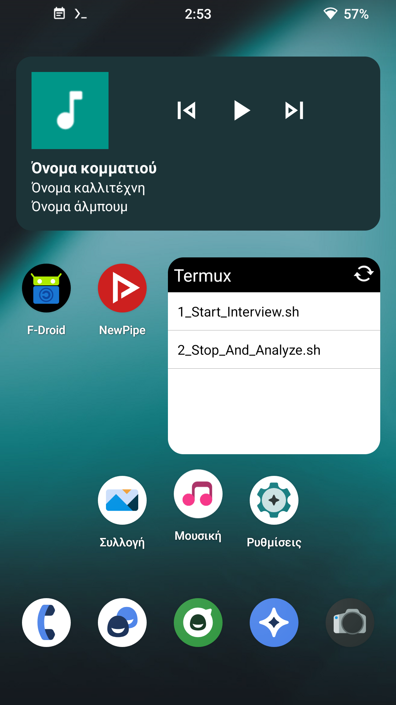
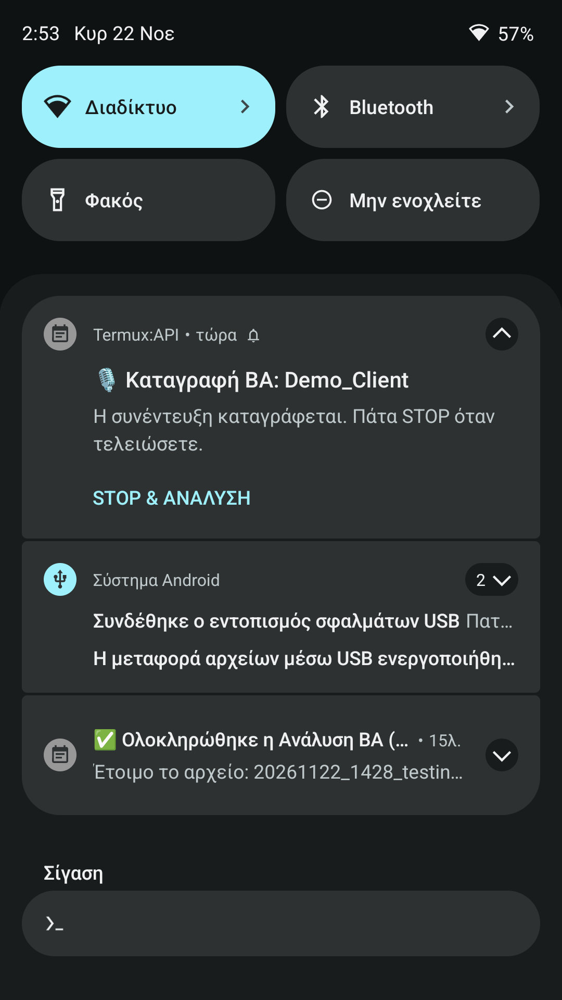

# Offline Business Analyst Recorder & AI Analyzer (Xiaomi Redmi Note 4 / LineageOS 20.0)

> *[Ελληνική έκδοση / Greek version](README.md)*

## 1. Overview

This documentation describes the installation, configuration, and usage of a fully offline Business Analysis (BA) interview recording, transcription, and requirements analysis system running on a **Xiaomi Redmi Note 4 (`mido`, `aarch64`)** with **LineageOS 20.0 (Android 13)** and **Termux**.

The architecture is 100% touch-first—requiring no keyboard and no internet connection during field interviews:
1. **Audio Recording:** `termux-microphone-record` (via `Termux:API`) records the interview in AAC (`.m4a`) format, and `ffmpeg` automatically converts it to 16 kHz mono PCM `.wav`.
2. **Transcription (Speech-to-Text):** `whisper.cpp` (`whisper-cli`) with the quantized Greek model `ggml-small-q5_1.bin` produces a full Greek transcript.
3. **Map-Reduce Requirements Analysis (LLM):** To prevent information loss during long client meetings, the transcript is split into 1,200-word chunks. `llama.cpp` (`llama-completion`) running `Qwen2.5-1.5B-Instruct (Q4_K_M)` extracts key facts per chunk (Map) and synthesizes a structured **Business Analysis Report** in Markdown (Reduce).

---

## 2. Prerequisites

### Device & OS
- **Device:** Xiaomi Redmi Note 4 (`mido`, `aarch64`) running LineageOS 20.0 (Android 13) with sufficient free storage (~2 GB for source code, dependencies, and models).
- **Wi-Fi Connection:** Required only during initial package installation and model downloads.
- **Linux Host (optional, for automated setup):** `android-tools` (`adb`), `curl`, `ssh`.

### Android Apps (Exclusively from F-Droid)
All three Termux packages must be installed from **F-Droid** so they share the same signing key and `userId`:
1. **`com.termux`** (`Termux`)
2. **`com.termux.api`** (`Termux:API`)
3. **`com.termux.widget`** (`Termux:Widget`)
4. *(Optional for wireless sync)* **`Syncthing-Fork`** (`v2.1.7.0`, `arm64-v8a`)

### Termux Packages
- `git`, `cmake`, `clang`, `make`, `wget`, `coreutils`, `findutils`, `termux-api`, `ffmpeg`, `openssh`

### AI Models (~1.3 GB total)
- **Whisper:** `ggml-small-q5_1.bin` (~182 MB)
- **LLM:** `qwen2.5-1.5b-instruct-q4_k_m.gguf` (~1.1 GB)

---

## 3. Step-by-Step Guide

### Phase A: App Installation & Permissions (via ADB)

1. Enable **USB Debugging** on the device (*Settings → About phone → tap Build number 7 times → System → Developer options → USB debugging*).
2. Download the official F-Droid APKs and install them via `adb`:
   ```bash
   curl -fSL -o com.termux.apk https://f-droid.org/repo/com.termux_1002.apk
   curl -fSL -o com.termux.api.apk https://f-droid.org/repo/com.termux.api_1002.apk
   curl -fSL -o com.termux.widget.apk https://f-droid.org/repo/com.termux.widget_1001.apk

   adb install com.termux.apk
   adb install com.termux.api.apk
   adb install com.termux.widget.apk
   ```
3. Grant runtime permissions for microphone, notifications, overlay, and storage:
   ```bash
   adb shell "
   pm grant com.termux.api android.permission.RECORD_AUDIO
   pm grant com.termux.api android.permission.POST_NOTIFICATIONS
   pm grant com.termux android.permission.POST_NOTIFICATIONS
   pm grant com.termux android.permission.READ_EXTERNAL_STORAGE
   pm grant com.termux android.permission.WRITE_EXTERNAL_STORAGE
   appops set com.termux.widget SYSTEM_ALERT_WINDOW allow
   appops set com.termux.api SYSTEM_ALERT_WINDOW allow
   appops set com.termux SYSTEM_ALERT_WINDOW allow
   appops set com.termux MANAGE_EXTERNAL_STORAGE allow
   dumpsys deviceidle whitelist +com.termux +com.termux.api +com.termux.widget
   settings put global settings_enable_monitor_phantom_procs false
   device_config put activity_manager max_phantom_processes 2147483647
   "
   ```

### Phase B: Installing Tools, Models & Scripts in Termux

4. Launch Termux on the device (to initialize its bootstrap environment) and run `scripts/install_on_device.sh`:
   - Updates Termux packages and installs `git`, `cmake`, `clang`, `make`, `wget`, `termux-api`, `ffmpeg`, `openssh`.
   - Compiles `whisper.cpp` (`-j4`) and downloads the `small-q5_1` model.
   - Compiles `llama.cpp` (`-DLLAMA_CURL=OFF`, `--target llama-completion llama-cli`) and downloads `qwen2.5-1.5b-instruct-q4_k_m.gguf`.
   - Enables `allow-external-apps = true` in `~/.termux/termux.properties` and runs `termux-reload-settings`.
5. Place the operational scripts in Termux:
   - `scripts/ba-engine.sh` → `~/ba-engine.sh`
   - `scripts/1_Start_Interview.sh` → `~/.shortcuts/1_Start_Interview.sh`
   - `scripts/2_Stop_And_Analyze.sh` → `~/.shortcuts/2_Stop_And_Analyze.sh`
   - Set executable permissions:
     ```bash
     chmod +x ~/ba-engine.sh ~/.shortcuts/1_Start_Interview.sh ~/.shortcuts/2_Stop_And_Analyze.sh
     ```

### Phase C: Adding the Home Screen Widget & Field SOP

6. **Adding the Widget to the LineageOS Home Screen:**
   1. Go to the Home Screen and **long-press** an empty area.
   2. Tap **Widgets**.
   3. Scroll to **Termux:Widget** (note: select the list *Widget* `Termux:Widget`, not the app icon from the app drawer).
   4. Long-press the **Termux:Widget** (shortcut list) and drag it onto the Home Screen.
   5. The two buttons `1_Start_Interview.sh` and `2_Stop_And_Analyze.sh` appear inside the widget (if they do not appear immediately, tap the small refresh icon `↻` at the top-right of the widget).

   

7. **Workflow & Operation (Field SOP):**
   1. **Start Recording:**
      - Tap `1_Start_Interview.sh` on the widget.
      - An Android pop-up dialog appears: enter the client/project name (e.g., `Dimos_Thessalonikis`) and tap **OK** (if left blank, `Client_HHMM` is used automatically).
      - Recording starts automatically and a persistent notification **`🎙️ Καταγραφή BA: <CLIENT>`** is displayed.
      - The screen can be locked/turned off; `termux-wake-lock` keeps the process active in the background throughout the meeting.
   2. **Stop Recording & Automatic Processing:**
      - When the interview ends, stop recording in either of two ways:
        - Pull down the notification shade (or from the lockscreen) and tap **STOP & ΑΝΑΛΥΣΗ** on the persistent notification, **or**
        - Tap `2_Stop_And_Analyze.sh` on the Home Screen widget.
      - A confirmation toast appears and the phone can be locked/put away. In the background, the pipeline runs sequentially:
        1. **`⏳ [1/2] Απομαγνητοφώνηση...`**: Converts `.m4a → .wav` (`ffmpeg`) and transcribes speech to Greek text (`whisper-cli`).
        2. **`🧠 [2/2] Ανάλυση Απαιτήσεων BA...`**: Splits text into 1,200-word chunks and runs Map-Reduce synthesis via `Qwen2.5-1.5B` (`llama-completion`).
   3. **Completion:**
      - Once analysis finishes, the device vibrates and displays: **`✅ Ολοκληρώθηκε η Ανάλυση BA (<CLIENT>)`**.

   

### Phase D: Locating Output Files, Syncthing-Fork Setup & PC Transfer

8. **Where files are stored on the phone:**
   All generated files are saved to shared internal storage:
   - **System path:** `/sdcard/Documents/interviews/`
   - **Via Android Files app:** *Internal Storage → `Documents` → `interviews`*

   Each interview produces 4 files:
   - `<YYYYMMDD_HHMM>_<CLIENT>.m4a` — Raw recording (AAC)
   - `<YYYYMMDD_HHMM>_<CLIENT>.wav` — 16 kHz mono PCM audio (for audit / Whisper)
   - `<YYYYMMDD_HHMM>_<CLIENT>_transcript.txt` — Full transcript
   - `<YYYYMMDD_HHMM>_<CLIENT>_BA_analysis.md` — Final structured BA report (Markdown)

9. **Setting up Syncthing-Fork for automatic PC sync:**
   1. **On the phone (Syncthing-Fork):**
      - Open **Syncthing-Fork** and grant the storage/notification permissions requested on first launch.
      - Go to the **Folders** tab → tap **`+`** (Add Folder):
        - **Folder Label:** `BA Interviews` (or preferred name)
        - **Folder Path:** Select `/storage/emulated/0/Documents/interviews` (`Documents/interviews`).
      - Save (✓).
   2. **On the computer (Linux / Fedora / macOS / Windows):**
      - Install and start `syncthing` (on Fedora: `sudo dnf install syncthing && systemctl --user enable --now syncthing`), then open the Web UI (`http://127.0.0.1:8384`).
      - Click **Add Remote Device**: scan the QR code or copy the **Device ID** from *Show Device ID* in Syncthing-Fork on the phone, and accept the connection on the phone.
      - Share the `BA Interviews` folder from the phone to the computer (*Sharing* tab in the folder settings in Syncthing-Fork) and accept the folder on the computer (choose a local destination, e.g., `~/BA_Interviews`).
      - Whenever the phone connects to Wi-Fi, all 4 files per interview sync automatically to the computer.
   3. **Alternative manual transfer (without Wi-Fi / Syncthing):**
      - **Via USB (MTP):** Connect via USB → select *File Transfer* from the notification shade → open `Documents/interviews`.
      - **Via `adb pull`:** `adb pull /sdcard/Documents/interviews/ ./interviews_backup/`

---

## 4. Configuration Files

### `~/.termux/termux.properties` (Required setting)
```properties
allow-external-apps = true
```

### `~/ba-engine.sh`
```bash
#!/data/data/com.termux/files/usr/bin/bash
set -euo pipefail

WORK_DIR="/sdcard/Documents/interviews"
mkdir -p "$WORK_DIR"
WHISPER_BIN="$HOME/whisper.cpp/build/bin/whisper-cli"
WHISPER_MODEL="$HOME/whisper.cpp/models/ggml-small-q5_1.bin"
LLAMA_BIN="$HOME/llama.cpp/build/bin/llama-completion"
LLAMA_MODEL="$HOME/llama.cpp/models/qwen2.5-1.5b-instruct-q4_k_m.gguf"
PID_FILE="$HOME/.ba_recording.pid"

CLIENT_NAME="${1:-client}"
# Καθαρισμός ονόματος αρχείου από κενά/ειδικούς χαρακτήρες
CLIENT_SLUG=$(echo "$CLIENT_NAME" | tr " " "_" | tr -cd "[:alnum:]_-")
[ -z "$CLIENT_SLUG" ] && CLIENT_SLUG="client"

TIMESTAMP=$(date +"%Y%m%d_%H%M")
BASE_FILE="$WORK_DIR/${TIMESTAMP}_${CLIENT_SLUG}"
RAW_AUDIO="${BASE_FILE}.m4a"
AUDIO_FILE="${BASE_FILE}.wav"
TRANSCRIPT_FILE="${BASE_FILE}_transcript.txt"
SUMMARY_FILE="${BASE_FILE}_BA_analysis.md"
LOG_FILE="${BASE_FILE}.log"
TMP_DIR=$(mktemp -d)

exec 2>>"$LOG_FILE"

on_error() {
  local line="$1"
  echo "[$(date +"%H:%M:%S")] ERROR at line $line" >> "$LOG_FILE"
  termux-notification-remove "ba_rec" || true
  termux-notification-remove "ba_proc" || true
  termux-notification \
    --id "ba_err" \
    --title "❌ Σφάλμα Ανάλυσης BA ($CLIENT_NAME)" \
    --content "Δες το log: $(basename "$LOG_FILE")" || true
}
trap 'on_error $LINENO' ERR

cleanup() {
  rm -rf "$TMP_DIR"
  rm -f "$PID_FILE"
  termux-wake-unlock || true
}
trap cleanup EXIT

termux-wake-lock

# Εμφάνιση μόνιμης ειδοποίησης στην οθόνη με κουμπί STOP
termux-notification \
  --id "ba_rec" \
  --title "🎙️ Καταγραφή BA: $CLIENT_NAME" \
  --content "Η συνέντευξη καταγράφεται. Πάτα STOP όταν τελειώσετε." \
  --ongoing \
  --button1 "STOP & ΑΝΑΛΥΣΗ" \
  --button1-action "$HOME/.shortcuts/2_Stop_And_Analyze.sh"

# Έναρξη εγγραφής σε AAC (m4a)
termux-microphone-record -f "$RAW_AUDIO" -e aac -r 16000 -c 1 -l 0 >/dev/null
echo "RECORDING" > "$PID_FILE"

# Αναμονή μέχρι να διαγραφεί το PID_FILE (από το κουμπί STOP)
while [ -f "$PID_FILE" ]; do
  sleep 1
done

# Τερματισμός μικροφώνου & μετατροπή σε 16kHz mono PCM WAV για whisper.cpp
termux-microphone-record -q >/dev/null
sleep 1
termux-notification-remove "ba_rec" || true

# Ενημέρωση progress: Φάση Whisper
termux-notification \
  --id "ba_proc" \
  --title "⏳ [1/2] Απομαγνητοφώνηση..." \
  --content "Μετατροπή ομιλίας σε κείμενο ($CLIENT_NAME)..." \
  --ongoing

ffmpeg -y -i "$RAW_AUDIO" -ar 16000 -ac 1 -c:a pcm_s16le "$AUDIO_FILE" >/dev/null 2>&1

"$WHISPER_BIN" \
  -m "$WHISPER_MODEL" \
  -f "$AUDIO_FILE" \
  -l el \
  -t 6 \
  -otxt \
  -of "${BASE_FILE}_transcript" >/dev/null 2>&1

# --- Φάση 2: Map-Reduce Chunking για μηδενική απώλεια πληροφορίας ---
termux-notification \
  --id "ba_proc" \
  --title "🧠 [2/2] Ανάλυση Απαιτήσεων BA..." \
  --content "Επεξεργασία τμημάτων με Qwen2.5-1.5B..." \
  --ongoing

# Σπάσιμο του transcript σε κομμάτια των 700 λέξεων (ασφαλές για -c 2048 και 3.5GB RAM)
tr -s "[:space:]" "\n" < "$TRANSCRIPT_FILE" | split -l 700 -d - "$TMP_DIR/words_"

COMBINED_NOTES="$TMP_DIR/combined_notes.txt"
: > "$COMBINED_NOTES"

CHUNK_IDX=1
for WORD_FILE in "$TMP_DIR"/words_*; do
  [ -e "$WORD_FILE" ] || continue
  CHUNK_TEXT=$(tr "\n" " " < "$WORD_FILE")
  MAP_PROMPT="$TMP_DIR/map_prompt_${CHUNK_IDX}.txt"

  cat << EOP > "$MAP_PROMPT"
<|im_start|>system
Είσαι Business Analyst. Εξάγεις ΜΟΝΟ τα ουσιαστικά γεγονότα, προβλήματα, λειτουργικές απαιτήσεις, περιορισμούς και ερωτήματα από το απόσπασμα συνέντευξης. Μη χάνεις καμία λεπτομέρεια. Γράψε συνοπτικά bullet points στα Ελληνικά.<|im_end|>
<|im_start|>user
Απόσπασμα #$CHUNK_IDX:
$CHUNK_TEXT<|im_end|>
<|im_start|>assistant
EOP

  echo "--- Σημειώσεις Τμήματος $CHUNK_IDX ---" >> "$COMBINED_NOTES"
  "$LLAMA_BIN" \
    -m "$LLAMA_MODEL" \
    -f "$MAP_PROMPT" \
    -c 2048 \
    -n 512 \
    -t 6 \
    --temp 0.1 \
    --repeat-penalty 1.15 \
    --no-display-prompt -no-cnv \
    -e >> "$COMBINED_NOTES"
  echo "" >> "$COMBINED_NOTES"

  CHUNK_IDX=$((CHUNK_IDX + 1))
done

# --- Τελική Σύνθεση (Reduce) ---
REDUCE_PROMPT="$TMP_DIR/reduce_prompt.txt"
cat << EOP > "$REDUCE_PROMPT"
<|im_start|>system
Είσαι Senior Business & Systems Analyst. Συνθέτεις τις σημειώσεις μιας συνέντευξης πελάτη σε ένα ολοκληρωμένο, επαγγελματικό έγγραφο απαιτήσεων στα Ελληνικά.
Απαγορεύεται να επινοήσεις πληροφορίες που δεν υπάρχουν στις σημειώσεις. Χρησιμοποίησε καθαρό Markdown.<|im_end|>
<|im_start|>user
Με βάση τις παρακάτω εξαχθείσες σημειώσεις από όλη τη διάρκεια της συνέντευξης, σύνταξε την τελική ανάλυση στις εξής 5 ενότητες:

1. **Σύνοψη Συνέντευξης (Executive Summary)** (3-5 προτάσεις)
2. **Επιχειρηματικά Προβλήματα & Στόχοι (Pain Points)**
3. **Λειτουργικές Απαιτήσεις (Functional Requirements)**
4. **Μη Λειτουργικές Απαιτήσεις & Περιορισμοί (Security, Integrations, Budget, Χρονοδιάγραμμα)**
5. **Ανοιχτά Ερωτήματα & Ασάφειες προς Διευκρίνιση (Open Questions)**

Σημειώσεις Συνέντευξης:
$(cat "$COMBINED_NOTES")<|im_end|>
<|im_start|>assistant
EOP

{
  echo "# Business Analysis: $CLIENT_NAME"
  echo "- **Ημερομηνία:** $(date +"%d/%m/%Y %H:%M")"
  echo "- **Αρχείο Ήχου:** \`$(basename "$AUDIO_FILE")\`"
  echo "- **Απομαγνητοφώνηση:** \`$(basename "$TRANSCRIPT_FILE")\`"
  echo ""
  echo "---"
  echo ""
  "$LLAMA_BIN" \
    -m "$LLAMA_MODEL" \
    -f "$REDUCE_PROMPT" \
    -c 3072 \
    -n 1024 \
    -t 6 \
    --temp 0.2 \
    --repeat-penalty 1.15 \
    --no-display-prompt -no-cnv \
    -e
} > "$SUMMARY_FILE"

termux-notification-remove "ba_proc" || true
termux-vibrate -d 300 || true
termux-notification \
  --id "ba_done" \
  --title "✅ Ολοκληρώθηκε η Ανάλυση BA ($CLIENT_NAME)" \
  --content "Έτοιμο το αρχείο: $(basename "$SUMMARY_FILE")"
```

### `~/.shortcuts/1_Start_Interview.sh`
```bash
#!/data/data/com.termux/files/usr/bin/bash

if [ -f "$HOME/.ba_recording.pid" ]; then
  termux-toast "Υπάρχει ήδη ενεργή ηχογράφηση!"
  exit 1
fi

# Εμφανίζει native Android pop-up πληκτρολόγιο για όνομα πελάτη
RESPONSE=$(termux-dialog text -t "Νέα Συνέντευξη BA" -i "Όνομα Πελάτη / Project")
CLIENT=$(echo "$RESPONSE" | grep -o '"text": *"[^"]*"' | cut -d'"' -f4)

if [ -z "$CLIENT" ]; then
  CLIENT="Client_$(date +%H%M)"
fi

termux-toast "Ξεκίνησε η καταγραφή για: $CLIENT"
nohup "$HOME/ba-engine.sh" "$CLIENT" >/dev/null 2>&1 &
```

### `~/.shortcuts/2_Stop_And_Analyze.sh`
```bash
#!/data/data/com.termux/files/usr/bin/bash

if [ -f "$HOME/.ba_recording.pid" ]; then
  rm -f "$HOME/.ba_recording.pid"
  termux-toast "Η εγγραφή σταμάτησε. Ξεκινάει η AI ανάλυση..."
else
  termux-toast "Δεν βρέθηκε ενεργή ηχογράφηση."
fi
```

---

## 5. Verification

- **Installation & Permissions:**
  - `com.termux` (`0.118.3`), `com.termux.api` (`0.53.0`), and `com.termux.widget` (`0.15.0`) installed from F-Droid with shared `userId`.
  - `allow-external-apps = true` enabled in `~/.termux/termux.properties`.
- **Binaries & Models:**
  - `~/whisper.cpp/build/bin/whisper-cli` (`5.5M`) + `ggml-small-q5_1.bin` (`182M`).
  - `~/llama.cpp/build/bin/llama-completion` + `qwen2.5-1.5b-instruct-q4_k_m.gguf` (`1.1G`).
- **End-to-End Pipeline:**
  - `termux-toast` & `termux-notification`: verified notification creation and removal.
  - `termux-microphone-record -e aac` → `ffmpeg` (`.m4a` → 16 kHz mono `.wav`) → `whisper-cli -l el`: successfully produced transcript output.
  - `llama-completion -no-cnv --no-display-prompt -e`: ran without chat banner, generated Greek output (~9.0 t/s prompt eval, ~5.4 t/s generation on Snapdragon 625), and exited cleanly.
- **Termux:Widget:** `1_Start_Interview.sh` and `2_Stop_And_Analyze.sh` appear and execute from the Home Screen.

---

## 6. Troubleshooting & Known Issues

1. **`whisper-cli` fails with `failed to read audio data`:**
   - *Cause:* `termux-microphone-record` on Android ignores `-e pcm` and writes an `mp42` (`aac`) container.
   - *Fix:* Record explicitly with `-e aac` to `.m4a` and convert using `ffmpeg -y -i "$RAW_AUDIO" -ar 16000 -ac 1 -c:a pcm_s16le "$AUDIO_FILE"` before invoking `whisper-cli`.
2. **`llama-cli` hangs waiting for input or prints an ASCII banner into Markdown:**
   - *Cause:* Newer `llama.cpp` builds (`b1-9c10c94`) launch `llama-cli` in interactive conversation mode by default.
   - *Fix:* Build and invoke `llama-completion` with `-no-cnv --no-display-prompt -e 2>/dev/null`.
3. **`--log-disable` in `llama-completion` produces empty output:**
   - *Cause:* `--log-disable` suppresses output in this version.
   - *Fix:* Omit `--log-disable` and redirect only `stderr` (`2>/dev/null`).
4. **Shortcuts do not appear on the Home Screen:**
   - *Cause:* The `Termux:Widget` app icon was placed instead of the Android Widget, or `allow-external-apps = true` is not enabled.
   - *Fix:* Add the **Widget** (*Long-press Home Screen → Widgets → Termux:Widget*) and ensure `allow-external-apps = true` is set in `~/.termux/termux.properties`.
5. **Processing stops after Whisper without creating `_BA_analysis.md`:**
   - *Cause:* Android 13's Phantom Process Killer or LMKD terminates `llama-completion` in the background when running with `-c 4096` on a 3.5 GB RAM device.
   - *Fix:* Disable Phantom Process Killer (`settings_enable_monitor_phantom_procs=false`), add Termux packages to `deviceidle whitelist`, and use `-c 2048` / 700-word chunks in `ba-engine.sh`.

---

## 7. Lessons Learned

- **Shared signing key for Termux add-ons:** Installing `Termux`, `Termux:API`, and `Termux:Widget` exclusively from F-Droid is mandatory so they share the same `userId` and access permissions to `~/.shortcuts`.
- **Use `llama-completion` for batch/script pipelines:** In recent `llama.cpp` builds, `llama-completion -no-cnv` replaces `llama-cli` for non-interactive shell automation.
- **Verify Android audio container formats:** `termux-microphone-record` wraps Android's `MediaRecorder` (AAC/AMR/Opus); including `ffmpeg` in the pipeline guarantees 100% compatibility with `whisper.cpp`.
- **Thermal & power management:** Using `-t 6` (instead of 8) and `-j4` during compilation avoids thermal throttling and OOM on the Snapdragon 625, while `termux-wake-lock` ensures uninterrupted background execution with the screen off.
